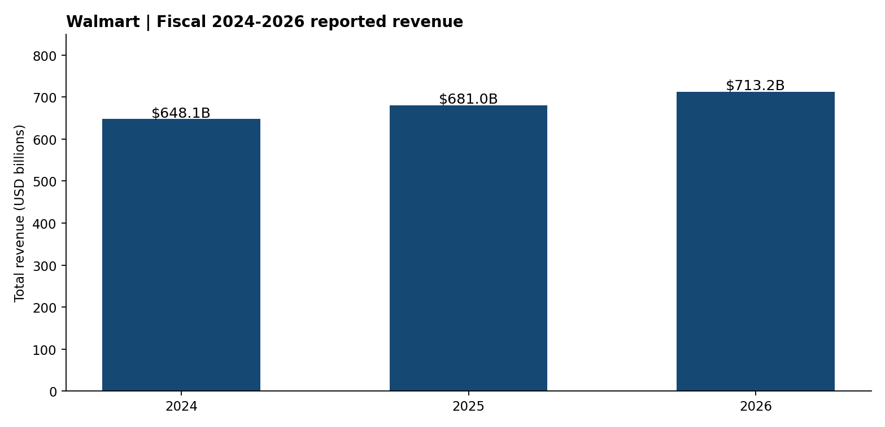

# Walmart | Fundamental Analysis and Illustrative DCF

**Role fit:** Investment Analyst · Corporate Finance · Capital Markets  
**Level:** Undergraduate, independent case study (not investment advice)  
**Currency:** USD millions throughout the model.



## Research question
What do the company's reported financials tell us about growth, profitability and reinvestment? How sensitive is a simple discounted cash flow estimate to assumptions?

## Evidence and model
- **Reported 2024–2026 figures** manually transcribed from Walmart's FY2026 10-K [official filing](https://www.sec.gov/Archives/edgar/data/104169/000010416926000055/wmt-20260131.htm).
- Excel model: `Walmart_Fundamentals_DCF.xlsx` — historical operating model, assumption inputs, 2027–2031 forecast, FCFF discounting, WACC vs terminal-growth sensitivity.
- Python script: `python src/analysis.py` creates reproducible graphs and numeric results.
- Executive brief: `Investment_Research_Brief.pdf` summarizes research findings and caveats.

## Key definitions
- Reported company FCF = operating cash flow - capital expenditure (Walmart non-GAAP reconciliation).
- **Forecast unlevered FCFF** = EBIT × (1 - modeled cash tax) + D&A - capex - change in NWC.
- Terminal value = final forecast FCFF × (1+g)/(WACC-g), with WACC > g.
- Assumption-driven **enterprise value** only; no share-price target or Buy/Sell/Hold rating.

## Limits and integrity
As of Oct 19, 2026, this case uses the latest fully reported FY2026 data (ended Jan 2026), not intervening quarterly releases. Growth, margins, tax and discount rates are **student-case assumptions**, not guidance or market consensus. No real-time share price, peer valuation, or complete capital structure bridge is included. DCF outputs are highly assumption-sensitive, including terminal value concentration. This is NOT investment advice and does not assert a professional valuation.

## Reproduce
```bash
pip install -r ../requirements.txt
python src/analysis.py
```

**Source record:** [data/SOURCE.md](data/SOURCE.md).
