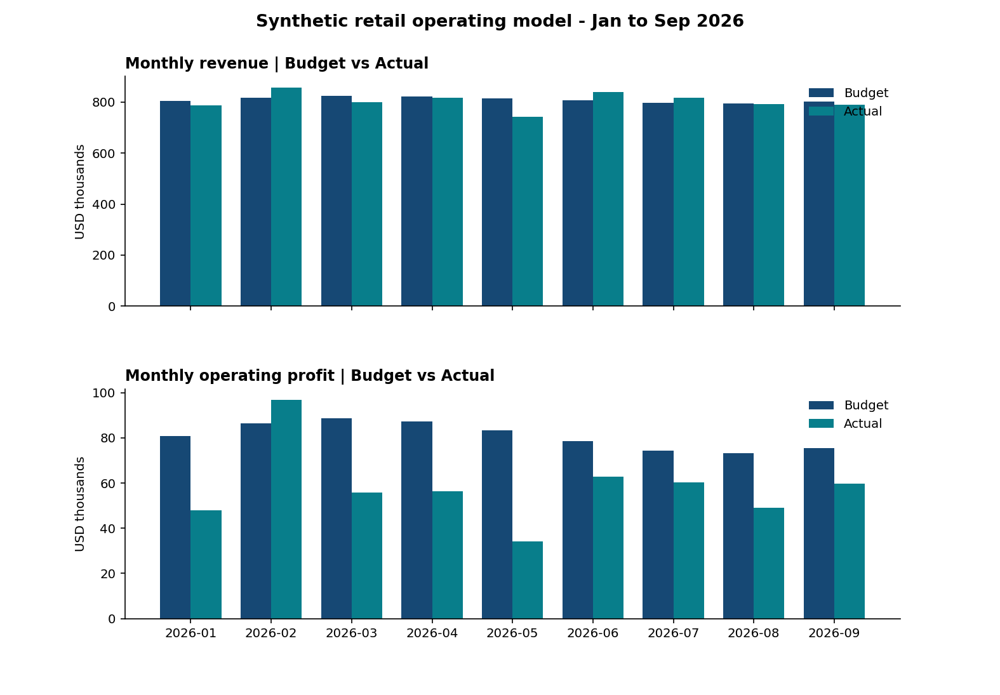

# Retail FP&A | Budget vs. Actual and Margin Analysis

**Role fit:** Financial Analyst · FP&A · Finance Transformation · Business Analyst  
**Data statement:** All records are **synthetically generated** for a teaching case — no employer or customer data is implied.



## Business question
A fictional three-product retailer has a plan and nine months of actual operating results. What caused the revenue and operating-profit gap? Which levers should management monitor?

## Contents
- `data/monthly_budget_actual_synthetic.csv`: generated records for 3 products x 9 months (Jan-Sep 2026).
- `src/generate_data.py`: random-seed-controlled data generator (seed 20261019).
- `src/analyze.py`: revenue/profit calculations, month-by-month variances, volume and price waterfall, plots.
- `src/q4_forecast.py`: simple October-December run-rate forecast with explicit assumptions; FY2026 outlook and chart.
- `FPandA_Budget_Actual_Model.xlsx`: transparent, formula-driven budget/actual comparison, 2026 Q4 run-rate forecast, metrics and scenario inputs.
- `FPandA_Management_Brief.pdf`: findings, recommendations, limitations.

## Key calculations
`Revenue = Units x Unit price`; `Contribution = Revenue - Units x Variable unit cost`; `Operating profit = Contribution - Fixed operating expenses`. Favorable variance is defined as **Actual - Budget** for revenue and profit. Revenue drivers reconcile as `(ActualUnits - BudgetUnits) x BudgetPrice` + `ActualUnits x (ActualPrice - BudgetPrice)`.

## Reproduce
```bash
pip install -r ../requirements.txt
python src/generate_data.py
python src/analyze.py
python src/q4_forecast.py
```

## Why synthetic?
The Q4 outlook starts from September run-rates, with monthly 1% unit growth, 0% price change, 0.5% unit-cost increase, and 0.3% fixed-cost increase. These are scenario assumptions, not statistical estimates. Internal monthly budgets are generally not public. This project demonstrates the analyst workflow without claiming inside knowledge of any company. Synthetic patterns are determined by code and should not be described as actual business performance or work experience.
