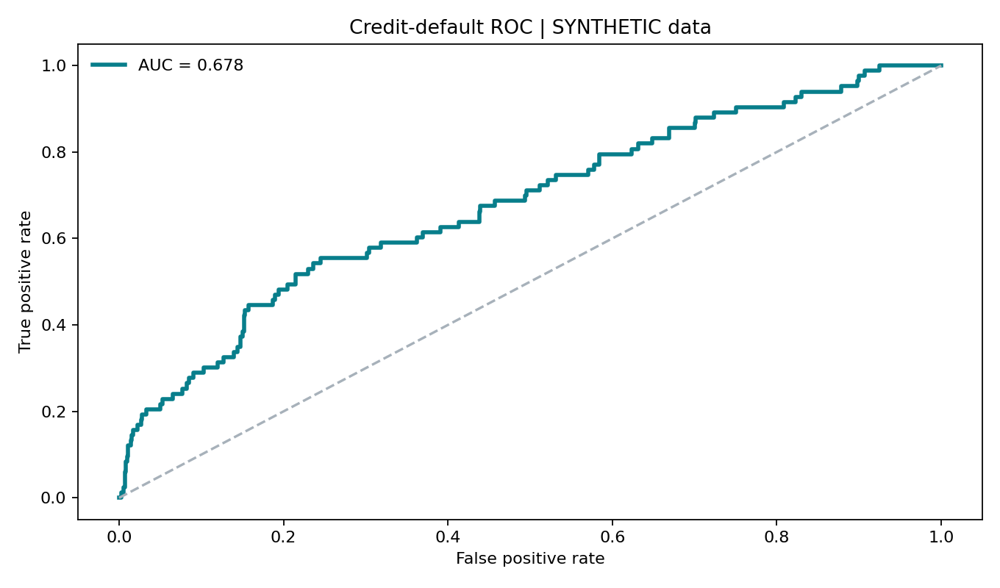

# Credit Risk | Introductory Logistic Regression Baseline

**Role fit:** Lending Analyst · Credit Analyst · Risk Analyst  
**Status:** A fully functioning synthetic-data demonstration is included. **A real-UCI-data model run requires the user to download the official dataset and run the code**; any current figures in `outputs/metrics_synthetic.json` refer ONLY to synthetic data.



## Question
Can observable credit/payment behavior help estimate the probability of default in an exploratory classification problem?

## Real dataset: source and reproducibility
- UCI Machine Learning Repository, **Default of Credit Card Clients** (ID 350): https://archive.ics.uci.edu/dataset/350/default+of+credit+card+clients
- Reference: Yeh, I-Cheng (2009), DOI https://doi.org/10.24432/C55S3H
- Original observations: **30,000 Taiwan credit-card accounts**, with historic repayment and billing variables and a following-month default indicator. This is *historical Taiwanese data*, not Canadian banking customers.
- UCI marks dataset license **CC BY 4.0**. Official raw data is not bundled here.

### Real dataset workflow
1. Download official ZIP from UCI; extract `default of credit card clients.xls` into `data/`.
2. Install dependencies: `pip install -r ../requirements.txt` (including `xlrd` for the legacy `.xls`).
3. Run:
   ```bash
   python src/analyze.py --data 'data/default of credit card clients.xls' --mode uci
   ```
4. Review `outputs/metrics_uci.json`, `roc_uci.png` and `risk_deciles_uci.png` before making any resume claim that includes real performance metrics.

### Included synthetic smoke test
```bash
python src/make_demo.py
python src/analyze.py --data data/demo_credit_synthetic.csv --mode synthetic
```
The synthetic rows are generated from an explicit probabilistic rule and are **not borrowed, sampled, or representative of the UCI observations**.

## Methodology
Train/test split 75/25 with fixed seed and stratification; missing-value median imputation and standardization fitted **on training data only**; logistic regression trained on training set; test AUC, average precision, Brier score, 0.20 illustrative-threshold confusion matrix and risk-decile plot.

`SEX`, `EDUCATION` and `MARRIAGE` variables are intentionally excluded from the real-UCI baseline; this is **not** a fairness guarantee.

## Limitations
The data is old, from another country, and lacks reliable deployment calibration, out-of-time testing and fairness review. This model is a **learning exercise**, not suitable for lending or real customer decisions. AUC assesses ranking quality, not whether predicted probabilities are accurate; accuracy alone can be misleading with class imbalance. Review calibration separately.
