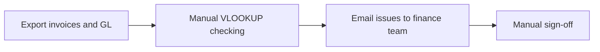
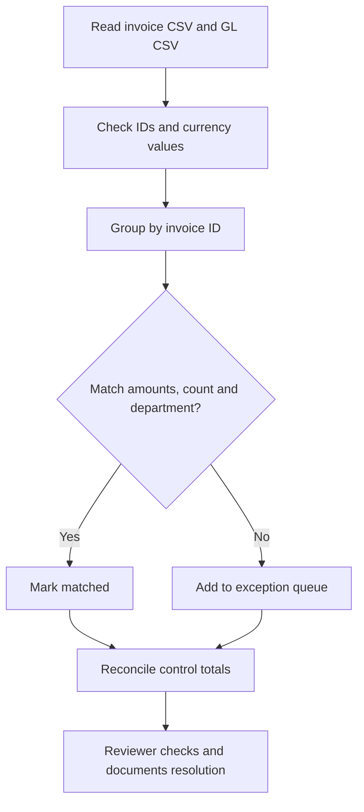

# Finance transformation case: example current-state vs proposed-state

**Educational, fictional process. This is not a record of an employer's actual control system.**

## Current-state illustrative process

## Proposed automated control

## Example testing/acceptance criteria
- An invoice missing from GL must be flagged and present in the exception queue.
- An extra GL posting must not silently pass a matched invoice.
- Dollar differences must be exact to cents and traceable to source rows.
- Total register and GL monetary amounts must reconcile to the difference reported.
- A human analyst reviews potential false positives before any accounting adjustment.
