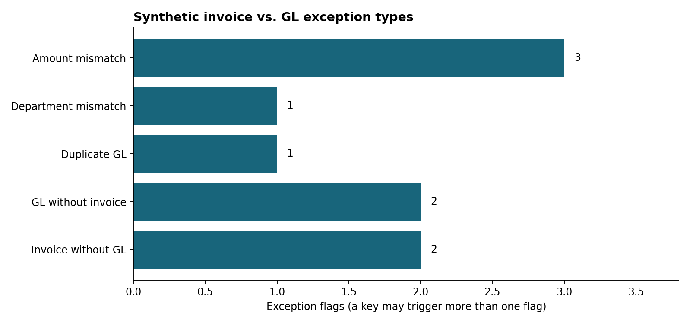

# Finance Process Automation | Invoice-to-General-Ledger Reconciliation

**Undergraduate finance transformation / accounting controls case study**  
**Data: 100% SYNTHETIC, deliberately injected anomalies. No real company's transactions.**



## Business question
How can a finance intern replace manual invoice-to-general-ledger checking with a reproducible control that highlights discrepancies for staff review?

## Workflow
1. `src/generate_data.py` creates 72 fictional invoices and 73 fictional ledger entries (random seed 20261019).
2. `src/reconcile.py` reads both CSVs and joins on invoice ID. It compares unique IDs, total amounts, duplicate postings, and departments.
3. `outputs/reconciliation_all_keys.csv` contains a complete audit trail; `outputs/exceptions_only.csv` is an exception queue for review.
4. `outputs/control_summary.json` and the chart summarize control results.
5. `tests/test_reconciliation.py` checks planted anomalies, ledger/register control totals, and counts.

## Demo findings (from synthetic records, **not a company's real results**)
- Register: 72 invoice rows; ledger: 73 postings; unique matching keys: 74.
- 66 keys pass both amount and department controls; **8 keys** have one or more exception flags.
- Aggregate invoice less ledger: **$-1,310.57 USD**, which is **not** sufficient alone to diagnose issues: use row-level exception details and duplicate controls.
- Duplicate GL, unmatched GL, invoices without postings, amount differences and inconsistent departments are all intentionally represented.

## Included Excel workbook
`Invoice_GL_Reconciliation_Control.xlsx` presents invoice register, GL journal, exported review queue and formula-driven total/count checks. Python identifies exceptions; Excel independently reconciles counts and dollar totals.

## Reproduce
```bash
python src/generate_data.py
python src/reconcile.py
python -m unittest discover -s tests -v
```

## Process improvement proposal
**As-is (illustrative):** monthly manual spreadsheet lookup, ad-hoc spot checks, unresolved cases tracked by email.  
**To-be (prototype):** import invoice and GL CSVs > normalize/validate IDs and currency > merge by invoice ID > flag duplicate/missing/amount/department exceptions > export a reviewer queue > reconcile totals and sign off.  

**Suggested reviewer triage:** prioritize missing postings and duplicates; send mismatches to the AP owner; keep evidence of resolution; record sign-off before month-end close. 

## Constraints and safeguards
- This is a **single-month teaching case**, not a measured production improvement, a real workflow implementation, nor a claim of hours saved.
- Real systems require vendor identity matching, tax and multi-currency handling, dates, partial payments, system access controls, approvals, data security, and a human sign-off process.
- Matching is by invoice ID, with exact cent-level amounts; department comparison is strict. No fuzzy matching or automatic journal corrections.
- Multiple flags may apply to one key. Exception counts must not be mistaken for distinct cases.
- Original data and injected anomalies are generated locally; **no source claims about external companies**.
